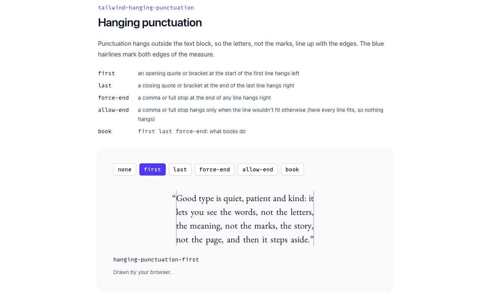
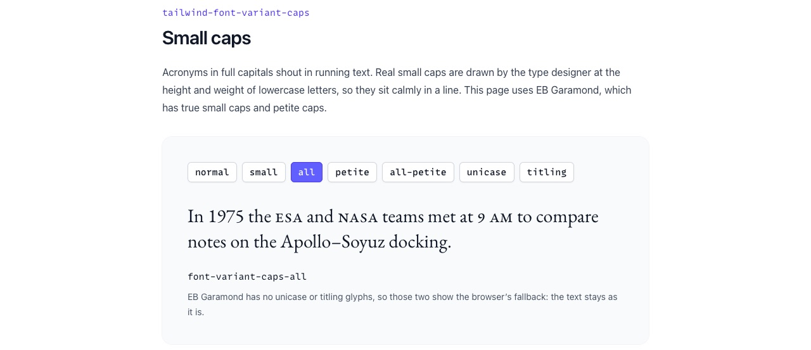
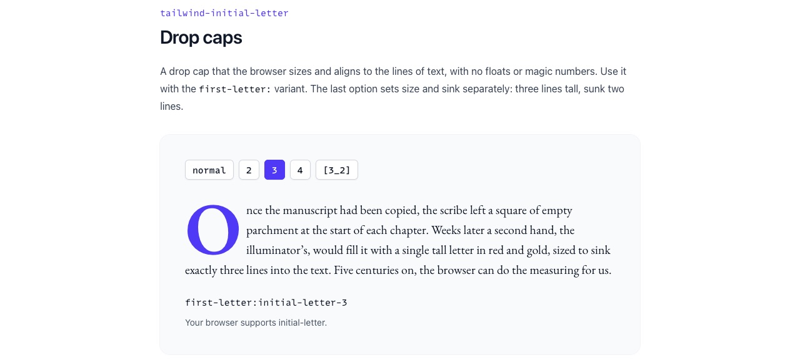

<div align="center">

# Tailwind Typography Extras

**Four tiny Tailwind CSS v4 packages** for the typography properties Tailwind doesn't ship: hanging punctuation, small caps, drop caps and text rendering.<br>
Each one is a single CSS file of `@utility` rules: no JavaScript, and variants and arbitrary values work as usual.

### [▶ See it at type.avolkov.dev](https://type.avolkov.dev)

Best in Safari: today it is the only browser that draws hanging punctuation.

<!-- Happy-path video: drag /private/tmp/claude-501/-Users-alex-Downloads-github/eba4b07d-fb10-47d6-8ce4-42740ad111e8/scratchpad/media/tailwind-typography-extras/happy-path.mp4 onto this line in the GitHub editor -->

  

</div>

## The packages

| Package | Property | Example |
| --- | --- | --- |
| [`tailwind-hanging-punctuation`](packages/tailwind-hanging-punctuation) | `hanging-punctuation` | `hanging-punctuation-first` |
| [`tailwind-font-variant-caps`](packages/tailwind-font-variant-caps) | `font-variant-caps` | `font-variant-caps-small` |
| [`tailwind-initial-letter`](packages/tailwind-initial-letter) | `initial-letter` | `first-letter:initial-letter-3` |
| [`tailwindcss-text-rendering`](packages/tailwindcss-text-rendering) | `text-rendering` | `rendering-precision` |

```sh
npm install tailwind-hanging-punctuation
```

```css
@import "tailwindcss";
@import "tailwind-hanging-punctuation";
```

Not affiliated with the official [`@tailwindcss/typography`](https://github.com/tailwindlabs/tailwindcss-typography) plugin (the `prose` classes). These packages each add one CSS property.

<details>
<summary>Upgrading from 1.x</summary>

2.0 is for Tailwind v4 only and replaces the JavaScript plugins with plain CSS. Remove the package from `plugins` in `tailwind.config.js` and add an `@import` instead. On Tailwind v3, stay on 1.x. The only renamed classes are in `tailwind-hanging-punctuation`: `forceEnd` → `force-end`, `allowEnd` → `allow-end`.

</details>

## Run it locally

Needs Node 24 or newer.

```sh
git clone --depth 1 https://github.com/slimcandy/tailwind-typography-extras.git
cd tailwind-typography-extras
npm install
npm test          # 31 checks against the real Tailwind v4 compiler
npm run build     # writes site/style.css; serve site/ with any static server
```

The tests are the judge: each package is loaded the way users load it (`@import "<package>"`), compiled by Tailwind's own compiler, and the CSS it produces is checked for every class, a variant, an arbitrary value and an unknown value. The demo page is plain HTML built with the Tailwind CLI; `scripts/share-card.mjs` makes the link-preview card and the home-screen icon from the page (needs Playwright), and `scripts/fetch-fonts.sh` fetches the licensed MonoLisa font at build time so it is never committed.

## Licence

Code: MIT, © 2023–2026 Aleksei Volkov. EB Garamond is under the SIL Open Font License ([site/fonts/OFL.txt](site/fonts/OFL.txt)).
