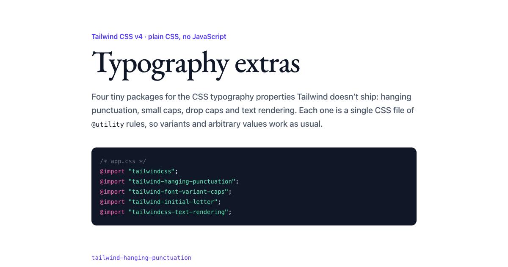

# Tailwind Typography Extras

Four tiny Tailwind CSS v4 packages for the typography properties Tailwind doesn't ship. Each one is a single CSS file of `@utility` rules: no JavaScript, and variants and arbitrary values work as usual.

<https://type.avolkov.dev>

[](https://type.avolkov.dev)

| Package | Property | Example |
| --- | --- | --- |
| [`tailwind-hanging-punctuation`](packages/tailwind-hanging-punctuation) | `hanging-punctuation` | `hanging-punctuation-first` |
| [`tailwind-font-variant-caps`](packages/tailwind-font-variant-caps) | `font-variant-caps` | `font-variant-caps-small` |
| [`tailwind-initial-letter`](packages/tailwind-initial-letter) | `initial-letter` | `first-letter:initial-letter-3` |
| [`tailwindcss-text-rendering`](packages/tailwindcss-text-rendering) | `text-rendering` | `rendering-precision` |

```sh
npm install tailwind-hanging-punctuation
```

```css
@import "tailwindcss";
@import "tailwind-hanging-punctuation";
```

Not affiliated with the official [`@tailwindcss/typography`](https://github.com/tailwindlabs/tailwindcss-typography) plugin.

## Upgrading from 1.x

2.0 is for Tailwind v4 only and replaces the JavaScript plugins with plain CSS. Remove the package from `plugins` in `tailwind.config.js` and add an `@import` instead. On Tailwind v3, stay on 1.x. The only renamed classes are in `tailwind-hanging-punctuation`: `forceEnd` → `force-end`, `allowEnd` → `allow-end`.

## Run it yourself

```sh
npm install
npm test        # compiles every class with the real Tailwind v4 compiler
npm run dev     # rebuilds site/style.css; serve site/ with any static server
```

The tests load each package the way users do (`@import "<package>"`), compile it with Tailwind's own compiler, and check the CSS it produces for every class, a variant, an arbitrary value and an unknown value.
